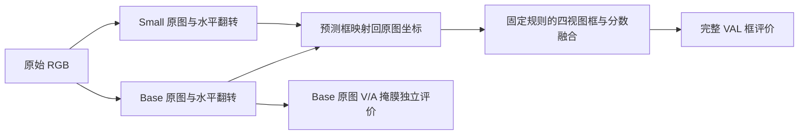

# 苹果识别与可见／完整实例分割：当前实验结果与具体方法

整理日期：2026-10-31（北京时间）  
实验范围：原 ConvNeXt-Base＋ConvNeXt-Small 强基线复现，以及从原 Base 权重出发的 C0/C1 短程对照。  
实验代码提交：`37399d3c33a9d3381f0248e211994bb6309e181a`。  
实验目录：`F:\研究生毕业设计\模块一定位补偿以及预测\apple_detection`。

## 1. 当前结论

**目前表现最好的仍是原 ConvNeXt-Base＋ConvNeXt-Small 四视图组合：Precision＝94.4343%，Recall＝90.0261%。**该结果已经在本机从两份原始权重、原始 RGB 图像重新推理完整验证集复现。

本轮 C0/C1 各完成 288 次成功更新。C0 为同预算的原图／翻转真值监督微调；C1 额外加入按同一 GT 实例配对的框与可见／完整掩膜一致性损失。两组均未超过原强基线，均未达到预定的提升门槛，实验已于 **2026-10-31 04:39** 按规则结束。

| 四视图组合 | Precision | Recall | F1 | TP | FP | FN |
|---|---:|---:|---:|---:|---:|---:|
| **原 Base＋原 Small** | **94.4343%** | **90.0261%** | **92.1775%** | 3105 | **183** | 344 |
| C0：288 步 Base＋原 Small | 94.2337% | 90.0261% | 92.0819% | 3105 | 190 | 344 |
| C1：288 步 Base＋原 Small | 94.2927% | 90.0551% | 92.1252% | 3106 | 188 | 343 |

表中各组均采用完整验证集上 **Recall≥90% 时 Precision 最高的工作点**。这些是框检测的 Precision／Recall／F1，不是 mAP，也不是独立测试集或实地采摘成功率。

相对原基线，C1 的 Precision 下降 **0.1417 个百分点**，净多检出 1 个苹果、增加 5 个误检。相对 C0，C1 少 2 个误检、净多检出 1 个苹果；这点差异不足以证明稳定的方法收益。**本轮没有达到 P≥96%、R≥90% 的提升目标。**

当前保留原模型；没有启动 1152 步长程训练，没有替换部署权重。所有本轮训练、评估进程已退出，节点跟进自动化已删除。

## 2. 数据集、标注与本轮训练范围

### 2.1 实际使用的数据

本轮强基线评估和 C0/C1 训练使用本地 **PApple** 数据。没有加入自采数据，也没有在本轮 C0/C1 中混入 MinneApple。

| 划分 | 图像数 | 苹果 GT 实例数 | 空 GT 图像数 | 用途 |
|---|---:|---:|---:|---|
| TRAIN | 2304 | 8579 | 14 | C0/C1 监督训练 |
| VAL | 814 | 3449 | 13 | 基线复现、阈值选择、候选验收 |

数据根目录：`F:\研究生毕业设计\模块一定位补偿以及预测\Apple_DualBranch_3080_20261022\assets\papple`。

标注来自各划分的 `gt_json/<split>/via_region_data_instance.json` 和 `via_region_data_amodal.json`，分别提供可见区域与完整区域标注。用 `apple_ID` 保持同一实例在两类标注和翻转视图之间的对应。

- **V（visible）**：实际可见的果皮区域。
- **A（amodal）**：包含被遮挡部分的完整果实区域标注。
- **H（hidden）**：该苹果的隐藏部分，监督由 `A \ V` 构造；它不是枝叶语义分割标签。
- 对有真实完整标注的 PApple，检测 GT 框由完整区域 A 的外接框形成。

RGB、GT、图像身份及原始标注哈希均参与核验。保留所有原始 GT 和空图，没有按预测效果删图、裁掉难例或补造真值。验证集中有 14 个“可见面积大于完整面积”的标注实例，保留并单独归组，没有通过修改标注改善分数。

数据清点证据：[本轮文档数据清单](F:/研究生毕业设计/模块一定位补偿以及预测/apple_detection/reports/strong_c0c1_20261030/document_dataset_inventory.json)。

### 2.2 TRAIN ignore map

沿用原训练记录中的 `train_ignore_full.json`：覆盖 **383 张 TRAIN 图、444 个候选框**。这些候选按原逻辑用于忽略相应负样本监督，不变成新的正例，不修改原 GT，也不用于验证集过滤。

文件位置：`F:\研究生毕业设计\模块一定位补偿以及预测\含权重\苹果检测成果包_20261029\02_证据\step1_20261026\train_ignore_full.json`。

SHA-256：`79d6e40e6ed74b179a159d491cb4940a7d2cdf5a979307cc6a6fc671e2d7d958`。

### 2.3 短程预算的准确含义

每次参数更新累积 4 张原始图，每张执行原图和水平翻转两次监督。因此，每组实际完成：

- 288 次成功更新，0 次跳过；
- 1152 次原图采样，2304 次视图前向／反向；
- 相当于 TRAIN 原图数量的约 0.5 遍，不能写成“完整训练 2 个 epoch”。

两组的原图索引、缩放尺寸和归一化输入 SHA 一致。原先配置的最大 1152 次更新，是提前固定的学习率调度和长程预算；本轮没有执行到该上限。

## 3. 当前强模型的实际架构

### 3.1 单模型结构

原 Base 和 Small 都属于**带 ROI 的两阶段检测与实例分割架构**。主要差别是骨干分别使用 ConvNeXt-Base、ConvNeXt-Small。本轮没有改成 YOLO、Query 学生、RT-DETR 或无 ROI 架构。

主要计算链路为：

1. RGB 输入经过 ConvNeXt 骨干和 256 通道 FPN，得到 P2–P5 多尺度特征，并有最大池化的 P6。
2. RPN 生成候选框；检测分支使用 ROI 特征、TwoMLPHead 和二分类 FastRCNNPredictor，输出苹果分数与回归框。
3. 掩膜分支对 P2–P5 做 MultiScaleROIAlign，ROI 特征尺寸为 28×28，V/H/A 掩膜 logits 输出为 56×56。
4. 使用已经存在的可见区域门控分类、完整区域修正和遮挡证据验证模块，随后使用原 `dual_mask` NMS 得到单视图候选。

V/H/A 的关系不是三个完全无关的平行输出：V 有自己的卷积塔；H 使用独立的卷积塔与上采样分支；A 保留原完整区域基础分支，再以 V 特征、V 概率和 H 概率为条件预测残差修正。完整掩膜不是简单地把 V 与 H 做集合并集。

具体地，若对应掩膜 logits 记为 ℓ，则：

\[
\ell_A=\ell_{A,base}+f_A(F_V,\sigma(\ell_V),\sigma(\ell_H)),
\qquad P_A=\sigma(\ell_A).
\]

原构造中实际启用了 `use_visible_gate`、`use_amodal_refinement`、`hidden_tower_mode=independent`、`amodal_base`、`occlusion_verifier` 和 `final_nms=dual_mask`。这些模块恢复的是已有权重，不能根据初始化配置名将它们描述为“本轮新加”或“仍为零初始化”。未启用的上下文 cascade、可见区域额外 RPN、浅层细节分支和高分辨率分类分支不计为本轮方法。

其中 `occlusion_verifier` 模块存在，而额外的 **verifier ranking loss 在本轮关闭**。两者不能混为同一个开关。

最终分类 logits 是 box 分类 logits 加 visible-gate 修正，再加 verifier 修正，推理分数取最终 logits 的前景 softmax。关闭 ranking 不会关闭 verifier 前向或冻结它：最终 logits 仍受到 VFL 分类监督。V/H/A 概率送入 verifier 时被 detach，因此分类梯度不会经这条路径直接回传到掩膜预测分支。本轮沿用原模型已有的可学习 verifier，没有新增后处理验证器。

源码依据：[OD 模型](F:/研究生毕业设计/模块一定位补偿以及预测/apple_detection/strong_runtime/src/apple_seg/od_model.py)、[ROI 与 V/H/A 实现](F:/研究生毕业设计/模块一定位补偿以及预测/apple_detection/strong_runtime/src/apple_seg/od_roi.py)。

### 3.2 两个模型与四个视图

“可见／完整分割”描述单模型的输出；“Base＋Small 四视图”描述推理时的集成方式。四个视图依次为：

1. Base 原图；
2. Base 水平翻转；
3. Small 原图；
4. Small 水平翻转。

翻转预测映射回原图坐标后，对**框和分数**进行融合。本文报告的四视图指标是融合框指标；可见／完整掩膜质量单独按 Base 原图评估，未声称实现四视图像素级掩膜融合。



### 3.3 原始权重与恢复方式

| 模型 | 原始权重位置 |
|---|---|
| Base | [validated_002304.pt](F:/研究生毕业设计/模块一定位补偿以及预测/含权重/苹果检测成果包_20261029/05_模型权重/convnext_base_c2_2304/validated_002304.pt) |
| Small | [validated_002304.pt](F:/研究生毕业设计/模块一定位补偿以及预测/含权重/苹果检测成果包_20261029/05_模型权重/convnext_small_joint2_2304/validated_002304.pt) |

```text
原 Base SHA-256
0fe257c5bfe115a77ac7deac830af479e4c2b0ad6ff69e609901b24c7980fa9b

原 Small SHA-256
e0c1f659c2509d7a01d617e12cb83c673768b440ea5b4b96cb4f763e4207e7e3
```

模型按 checkpoint 内构造参数重建，严格检查参数名、形状、类型、有限值及恢复后的数值相等性。Base 共 434 个参数／缓冲张量严格匹配。构造阶段的 `weights=None` 用于避免下载无关初始化权重，随后完整恢复交付权重；不是随机模型开始训练。

本轮属于**从原 Base 权重重新热启动的新实验**。旧训练入口、完整 Git 历史及原 EMA 历史未完整交付，不能称为旧训练进程的逐位续跑。两份原始权重在本轮结束后再次核验 SHA，文件字节未改变。

## 4. 固定四视图融合方法

输入图像按原评估流程保持长宽比缩放：目标短边 1024、长边上限 1280；FP32 推理。RGB 使用原归一化与双线性缩放流程，保留原模型的预处理和后处理。

| 设置 | 本轮固定值 |
|---|---|
| 跨视图聚类框 IoU 阈值 | 0.45 |
| 视图权重，按 Base 原图／翻转、Small 原图／翻转排序 | `[0.65, 0.65, 0.35, 0.35]` |
| 架构分组 | `[0, 0, 1, 1]` |
| 框融合 | 分数×视图权重的加权坐标平均 |
| 分数融合 | 视图权重加权平均，`score_mode=mean` |
| 跨架构一致性因子 | 1.10 |
| 单个视图孤立候选因子 | 0.90 |
| coverage floor | 1.0，不额外施加覆盖率折减 |

先按分数稳定排序，再以最高分未使用框作为聚类起点。满足 IoU≥0.45 的其他视图候选可以加入该簇，**同一簇每个视图最多保留一个框**。框匹配相对于该簇起始框进行，不是反复更新中心的聚类。

对簇中第 j 个候选，设框为 b_j、分数为 s_j、视图权重为 w_j：

\[
b_{fuse}=\frac{\sum_j w_j s_j b_j}{\sum_j w_j s_j},\qquad
s_{mean}=\frac{\sum_j w_j s_j}{\sum_j w_j}.
\]

若簇同时得到 Base 与 Small 的支持，在分数 odds 上乘 1.10；若簇只有一个候选，在 odds 上乘 0.90；同一骨干的两种视图共同支持时不应用上述跨架构奖励。实际变换为：

\[
s_{final}=\sigma\left(\operatorname{logit}(s_{mean})+\log k\right),
\]

其中 k 取对应因子，输入分数按原实现做数值边界保护。因子不是直接对概率乘 1.10 或减去 0.10。

这些融合设置在本轮固定，C0/C1 没有重新搜索融合参数。Small 的两份预测复用本次基线重推产生的固定缓存，并检查字节哈希相同。

依据：[固定融合配置](F:/研究生毕业设计/模块一定位补偿以及预测/apple_detection/configs/strong_baseline_4060.json)、[融合实现](F:/研究生毕业设计/模块一定位补偿以及预测/apple_detection/strong_runtime/tmp/flip_tta.py)。

## 5. C0/C1 的具体训练方法

### 5.1 对照设计

| 项目 | C0 | C1 |
|---|---|---|
| 初始化 | 同一原 Base 权重 | 同一原 Base 权重 |
| 可训练模块 | RPN、检测／分类和已有 V/H/A 等头部 | 与 C0 相同 |
| 骨干与 FPN | 冻结，保持 eval | 与 C0 相同 |
| 原图真值监督 | 有 | 有 |
| 翻转图真值监督 | 有 | 有 |
| 额外一致性 | 无 | 同 GT 的框、V、A 一致性 |
| 数据、种子与预算 | 相同 | 相同 |
| Small | 原权重固定，不参与训练 | 与 C0 相同 |

调用 `model.train()` 后重新将骨干和 FPN 置为 eval，避免冻结参数却改变训练／评估模式。优化器不含骨干和 FPN 参数。这里不是“只训练 ROI”，RPN 等现有头部也参与更新。

原图和翻转图顺序执行：先对原图监督反向，保存已 detach 的参考预测，再处理翻转图及一致性项。这样不用同时保留两套完整前向计算图。

### 5.2 原有监督损失

设完整真值监督损失为：

\[
\begin{aligned}
L_{GT}={}&L_{RPN,obj}+L_{RPN,box}+L_{VFL,cls}+L_{box}\\
&+(L_{V,BCE}+L_{V,Dice})\\
&+0.5(L_{H,BCE}+L_{H,Dice})\\
&+(L_{A,BCE}+L_{A,Dice}).
\end{aligned}
\]

分类沿用原 Varifocal Loss 配方，α＝0.75、γ＝2.0，正例质量目标取最终回归框与 GT 的 IoU。V/A 的 BCE 和 Dice 系数各为 1，H 的系数各为 0.5。额外 GIoU 权重为 0，额外遮挡权重 override 为 0，verifier ranking loss 关闭。

配置保留了 `classifier_negative_sampling=gate_ohem_half_heavy`，但实际 joint 训练路径没有调用 classifier-only 的该采样函数，不能将本轮写成“新启用了困难负样本挖掘”。

### 5.3 同一 GT 的对应与反翻转

从同一次实际训练 forward 捕获正例 proposals、匹配 GT、回归框和 V/A logits。对每个真实 GT ID，在其正例候选中选择与 GT 的 proposal IoU 最高者，建立原图与翻转图的对应；不通过两个预测框互相靠近来猜测实例身份。

设输入图像宽度为 W，翻转框为 `(x1', y1', x2', y2')`，还原为：

\[
(x_1,y_1,x_2,y_2)=(W-x'_2,\;y'_1,\;W-x'_1,\;y'_2).
\]

需要同时还原三类信息：

1. 最终 decoded box；
2. 产生掩膜 logits 的真实 ROI 支持框；
3. ROI 内的掩膜 logits，沿水平方向反转。

掩膜的空间支持使用原 proposal，而不是用最终 decoded box 替换。否则，即使 ROI 网格大小相同，格点也可能对应不同图像位置。

### 5.4 新增一致性损失

原图参考采用停止梯度 `stop_gradient`。翻转侧接受一致性梯度；原图仍接受其自身的完整真值监督梯度。

- **框一致性**：两侧框映射回统一坐标系，再除以 W/H 归一化，用 Smooth L1，β＝0.05；按匹配实例及四个坐标求均值。
- **V/A 一致性**：将 logits 转为概率，通过各自真实 ROI 支持框投影到同一个 GT 框内的 28×28 规范网格，使用双线性采样；只在两侧共同有效的支持区域计算概率 MSE。先按每个实例的有效采样点平均，再按实例平均。
- 没有共同 GT 时返回与计算图连接的零损失。没有共同有效掩膜区域时该掩膜项为零，框一致性仍可计算。
- 本轮没有新增 H、类别分数、背景负例或重复候选的一致性项。

令每次更新的原图累积数 M＝4，F 表示水平翻转，则：

\[
L_{C0}=\frac{1}{2M}\sum_{i=1}^{M}
\left[L_{GT}(x_i)+L_{GT}(Fx_i)\right],
\]

\[
L_{C1}=L_{C0}+\frac{\lambda}{2M}\sum_{i=1}^{M}
\left[L_{box,eq}^{(i)}+L_{V,eq}^{(i)}+L_{A,eq}^{(i)}\right],
\qquad \lambda=0.05.
\]

三项内部系数均为 1。一致性部分用 FP32 计算，模型主体训练用 BF16 自动混合精度。

这是一种**头部预测的几何等变一致性约束**。由于本轮骨干冻结，不能将其表述为“通过本轮训练让骨干学到新的全局遮挡表征”。它也没有直接对未匹配的背景误检施加新增监督。

实现：[一致性损失](F:/研究生毕业设计/模块一定位补偿以及预测/apple_detection/src/apple_strong/consistency.py)、[强模型训练实现](F:/研究生毕业设计/模块一定位补偿以及预测/apple_detection/src/apple_strong/training.py)。

## 6. 超参数与运行环境

| 参数 | 本轮实际设置 |
|---|---|
| 优化器 | AdamW |
| weight decay | 0.0001 |
| 原已有头部峰值学习率 | 0.000003，即 3×10⁻⁶ |
| 原新增头部参数组峰值学习率 | 0.000005，即 5×10⁻⁶ |
| 学习率来源 | 原配方对应头部学习率乘 0.1 |
| warmup | 前 50 次成功更新线性升温 |
| 后续调度 | 按预定 1152 步预算做余弦衰减，最终倍率 0.05 |
| 本轮实际更新 | 每组 288 次；288 处不重置调度 |
| 原图累积数 | 每次更新 4 张，每张 2 个监督视图 |
| 训练短边候选 | 768、896、1024，保持长宽比 |
| 训练长边上限 | 1536 |
| 验证短边／长边上限 | 1024／1280 |
| 数值精度 | 训练 BF16；完整评估 FP32 |
| 梯度裁剪范数 | 1.0 |
| 随机种子 | 20261030 |
| EMA decay | 0.999 |
| C1 一致性系数 | 0.05 |
| 保存间隔 | 每 50 次成功更新及结束边界 |
| CPU 线程数 | 4 |

第 1 次更新的两组学习率分别为 `6×10⁻⁸` 与 `1×10⁻⁷`；第 50 次达到上述峰值；第 288 次约为 `2.68439×10⁻⁶` 与 `4.47398×10⁻⁶`。原配方中的 backbone/FPN 学习率没有用于本轮冻结参数。

训练入口直接读取单张数据并串行处理，没有多进程 DataLoader 或 pin-memory 预取队列；保留梯度累积。一次仅运行一个 GPU 模型，评估顺序运行视图和模型。

| 环境项 | 实测版本／设备 |
|---|---|
| 本轮 GPU | NVIDIA GeForce RTX 4060 Laptop GPU，8188 MiB 显存 |
| Python | 3.11.15 |
| PyTorch | 2.12.1+cu132 |
| torchvision | 0.27.1+cu132 |
| transformers | 4.57.1 |
| NumPy | 2.4.6 |
| SciPy | 1.17.1 |
| Pillow | 12.3.0 |
| psutil | 7.2.2 |

使用的 Python 环境在 F 盘：`F:\研究生毕业设计\模块一定位补偿以及预测\apple_vision\local_amodal\envs\query_dual_v1`。目录名来自历史环境复用，不代表本轮加载了 query 模型。源码、模型、临时文件、缓存和输出均使用 F 盘目录。

EMA 的完整 shadow 保存在 CPU；`last.pt` 保存 live 参数、优化器、scaler、EMA、随机状态、采样器和更新边界。评估使用实际 EMA 候选，每个节点保存不可变快照。对参与 EMA 更新的浮点参数，288 步后初始 shadow 的递推系数为 `0.999^288≈0.74965`；这只是 EMA 混合系数，不表示“75%的参数没有训练”。

配置：[C0](F:/研究生毕业设计/模块一定位补偿以及预测/apple_detection/configs/strong_c0_4060.json)、[C1](F:/研究生毕业设计/模块一定位补偿以及预测/apple_detection/configs/strong_c1_4060.json)。环境依据：[环境快照](F:/研究生毕业设计/模块一定位补偿以及预测/apple_detection/reports/strong_c0c1_20261030/environment_snapshot.json)、[requirements.txt](F:/研究生毕业设计/模块一定位补偿以及预测/apple_detection/requirements.txt)。

## 7. 评估与晋级规则

### 7.1 框评价

按置信度降序、稳定排序逐图进行一对一 GT 匹配，IoU≥0.5 视为 TP；未匹配预测为 FP，未匹配 GT 为 FN。空图上的预测也计入 FP。

\[
P=\frac{TP}{TP+FP},\qquad
R=\frac{TP}{TP+FN},\qquad
F1=\frac{2PR}{P+R}.
\]

重放完整不同预测分数构成的阈值曲线，选择 R≥0.90 时 P 最高的点；并列时按 R、F1、阈值依次选择。本轮阈值由 VAL 选择，尚未证明在独立未见测试集上达到同样 P/R。

原基线必须先在固定 `confidence=0.75` 下复现 **TP=3105、FP=183、FN=344**，才允许进入训练。旧预测复算只用于融合代码核对，没有被用来冒充从权重重推的基线。

### 7.2 遮挡与掩膜评价

重遮挡定义为原标注的 `可见面积/完整面积 < 0.40`，VAL 共 1514 个该类实例。重遮挡 Recall 使用**四视图融合框**的匹配结果。

V/A 掩膜指标仅评价 **Base 原图**：在该 Base 自身的框 R90 工作点选取预测，用原生分辨率投影的掩膜与 GT 按 mask IoU≥0.5 独立匹配。掩膜匹配不只限于已经成为框 TP 的候选，也不等同于 mask AP。

### 7.3 提前声明的晋级条件

候选必须同时满足：

1. 四视图 P@R≥90 比复现基线提高至少 **0.2 个百分点**，即 P 至少约 **94.6343%**；
2. Recall≥90%；
3. 融合重遮挡框 Recall 下降不超过 0.5 个百分点；
4. Base 原图 V、A 掩膜实例 F1 各下降不超过 0.5 个百分点。

验收基于原始预测独立重算，并绑定候选权重 SHA、固定 Small 缓存、GT 和源码哈希。训练入口还校验基线的 10 项预测／摘要／掩膜产物实际哈希。

若至少一组达到条件，才能继续匹配预算的长程实验；另一组即使作为对照续跑，也不自动获得候选晋级资格。若两组都不满足，停止延长训练。本轮两组都因主 Precision 条件失败，其他保护指标在容差内，因此按规则结束。

依据：[正式双臂验收](F:/研究生毕业设计/模块一定位补偿以及预测/apple_detection/reports/strong_c0c1_20261030/short_comparison.json)。

## 8. 完整实验结果

### 8.1 原强模型各视图复现

| 视图 | P@R≥90 | 对应 Recall | TP | FP | FN |
|---|---:|---:|---:|---:|---:|
| Base 原图 | 94.0660% | 90.0841% | 3107 | 196 | 342 |
| Base 水平翻转 | 93.9486% | 90.0261% | 3105 | 200 | 344 |
| Small 原图 | 93.2153% | 90.0261% | 3105 | 226 | 344 |
| Small 水平翻转 | 92.7995% | 90.0551% | 3106 | 241 | 343 |
| 四视图固定融合 | **94.4343%** | **90.0261%** | 3105 | **183** | 344 |

单视图低于融合指标是这两个评价对象的实际差别，不能拿单视图数值直接判断四视图基线是否复现。

### 8.2 各组工作点与固定阈值对照

| 组别 | R90 最优置信度 | 固定置信度 0.75 的 Precision | 固定置信度 0.75 的 Recall | 固定阈值 TP/FP/FN |
|---|---:|---:|---:|---|
| 原基线 | 0.75052212 | 94.4343% | 90.0261% | 3105/183/344 |
| C0 | 0.74363943 | 94.3144% | 89.9391% | 3102/187/347 |
| C1 | 0.74334457 | 94.4022% | 89.9681% | 3103/184/346 |

固定 0.75 下 C0/C1 的 Recall 都略低于 90%。第 1 节的主表使用各自 R90 工作点，没有把固定阈值与重新选阈值后的数据混在一起。

### 8.3 遮挡与掩膜质量

| 指标 | 原基线 | C0，288 步 | C1，288 步 |
|---|---:|---:|---:|
| 融合重遮挡框 TP/GT | 1210/1514 | 1211/1514 | 1212/1514 |
| 融合重遮挡框 Recall | 79.9207% | 79.9868% | 80.0528% |
| Base 原图可见掩膜实例 F1 | 90.9064% | 90.8606% | 90.8472% |
| Base 原图完整掩膜实例 F1 | 91.8839% | 91.8679% | 91.8246% |

C1 相对原基线多检出 2 个重遮挡实例，但两类掩膜 F1 均下降约 0.0592 个百分点。此结果没有显示明显的重遮挡识别突破。

### 8.4 执行与工程验证

| 检查项 | 实测结论 |
|---|---|
| 新增 CPU 机制测试 | 76 项通过；反翻转、GT 对应、梯度、状态恢复、基线绑定和验收规则均有覆盖 |
| C0/C1 真实 GPU 压力 | 各 2 次成功更新，0 次跳过；冻结、更新、保存与真实重载检查通过 |
| 压力测试 PyTorch 峰值 reserved | C0 约 3.12 GiB；C1 约 3.07 GiB；不是整机显存占用 |
| C1 压力一致性信号 | 6 个非空匹配微批次验证到框/V/A 的非零一致性梯度 |
| C0 正式更新 | 288 成功，0 跳过；更新计时累计约 44.90 分钟 |
| C1 正式更新 | 288 成功，0 跳过；更新计时累计约 44.96 分钟 |
| 骨干/FPN | 冻结检查通过，没有梯度 |
| 评估 | 原基线、C0、C1 均完成整个 VAL；候选均为独立 EMA 快照 |
| 结束状态 | `complete_no_promotion`；没有执行长程训练 |

完整验证包含两视图、GT/RGB 审计和原生掩膜处理，其总耗时不能换算为部署端纯推理 FPS。本轮没有完成实时 FPS、TensorRT 或机器人端延迟验收。

## 9. 独立误差审计与本轮能够说明的结论

### 9.1 误检／漏检变化

按现有标注和各组自己的 R90 工作点进行空间对应审计：

- C0 中原基线 183 个 FP 均仍有对应，另增加 7 个：4 个定位偏差、2 个背景误检、1 个重复候选。新增 FN 2 个，同时挽回 FN 2 个，所以总 TP/FN 不变。
- C1 中原基线 183 个 FP 均仍有对应，另增加 5 个：2 个背景误检、2 个定位偏差、1 个重复候选。挽回 2 个原漏检、同时新增 1 个漏检，所以净多 1 个 TP。
- 相对 C0，C1 少 2 个 FP，净多 1 个 TP，没有证据显示它普遍清除了原模型的主要误检。

C1 相对 C0 的两处主要变化是：

| 图像 | 实测变化 | 含义 |
|---|---|---|
| `_MG_2690_16.png` | 框 IoU 从 0.499903 增至 0.507170 | 跨过固定 0.5 标准，由 FP/FN 变为 TP |
| `_MG_2691_22.png` | 最大 GT IoU 仍为 0.418764；分数 0.741029，低于 C1 R90 阈值 0.743345 | 定位偏差仍在，但该候选不再进入所选工作点 |

“背景误检”“定位偏差”等是相对于现有 GT 的自动匹配分类，不等于逐图人工确认了物理场景中所有目标。FP 空间对应也不代表不同模型的预测张量身份完全相同。

### 9.2 约束是否实际参与训练

C1 的 1152 个翻转训练视图中，7 个为空 GT；其余 1145 个正图均有共同 GT 对应，并产生非零 V/A 一致性损失，框一致性有 1135 个非零。结合压力测试的梯度证据，没有发现“新增项根本没有接入训练”的问题。

加权一致性在翻转视图中的均值约为 0.00086869，真值监督均值约为 0.945508。合并原图和翻转全部目标后，一致性／监督的标量比约为 0.0463%。这说明新增项的标量规模较小；**标量损失比不能直接当作梯度影响比**，所以不能仅凭此认定“系数太小就是失败原因”。

本轮 EMA＝0.999，短程评估较偏向初始权重；但没有 live 权重或其他 EMA 衰减的对照，不能据此声称 EMA 掩盖了已经产生的有效提升。

### 9.3 结论边界

本轮能够确认：在当前数据、固定强模型、冻结策略、学习率、EMA 和 288 步预算下，C1 未达到预先声明的晋级条件。新增 GT 正例几何一致性没有解决当前主要误检问题。

不能据本轮声称：C1 已取得稳定提升、已达到 P96/R90、已显著改善重遮挡、已证明 ROI 存在某个固定精度上限，或所有一致性训练与该模型架构都无效。本轮只有一个随机种子，且阈值与候选筛选在 VAL 上进行，没有独立测试或多次重复实验的统计证据。

审计文件：[C0 独立审计](F:/研究生毕业设计/模块一定位补偿以及预测/apple_detection/reports/strong_c0c1_20261030/C0_short_independent_audit.json)、[C1 独立审计](F:/研究生毕业设计/模块一定位补偿以及预测/apple_detection/reports/strong_c0c1_20261030/C1_short_independent_audit.json)。

## 10. 工程入口、候选文件与复核索引

| 用途 | 文件 |
|---|---|
| 环境与缓存定向到 F 盘 | [runtime_f_drive.ps1](F:/研究生毕业设计/模块一定位补偿以及预测/apple_detection/scripts/runtime_f_drive.ps1) |
| 从权重完整重推及固定融合 | [reproduce_strong_baseline.py](F:/研究生毕业设计/模块一定位补偿以及预测/apple_detection/scripts/reproduce_strong_baseline.py) |
| C0/C1 训练入口 | [train_strong.py](F:/研究生毕业设计/模块一定位补偿以及预测/apple_detection/scripts/train_strong.py) |
| 串行实验与门禁编排 | [strong_pipeline.py](F:/研究生毕业设计/模块一定位补偿以及预测/apple_detection/scripts/strong_pipeline.py) |
| 独立验收实现 | [acceptance.py](F:/研究生毕业设计/模块一定位补偿以及预测/apple_detection/src/apple_strong/acceptance.py) |
| 原基线原始结果与融合摘要 | [fusion_summary.json](F:/研究生毕业设计/模块一定位补偿以及预测/apple_detection/runs/strong_baseline_20261030/fusion_summary.json) |
| C0 完整融合结果 | [C0 fusion_summary.json](F:/研究生毕业设计/模块一定位补偿以及预测/apple_detection/runs/strong_C0_eval_000288_20261030/fusion_summary.json) |
| C1 完整融合结果 | [C1 fusion_summary.json](F:/研究生毕业设计/模块一定位补偿以及预测/apple_detection/runs/strong_C1_eval_000288_20261030/fusion_summary.json) |
| C0 全部训练记录 | [C0 training_summary.json](F:/研究生毕业设计/模块一定位补偿以及预测/apple_detection/runs/strong_C0_20261030/training_summary.json) |
| C1 全部训练记录 | [C1 training_summary.json](F:/研究生毕业设计/模块一定位补偿以及预测/apple_detection/runs/strong_C1_20261030/training_summary.json) |
| 基线放行证据 | [baseline_gate.json](F:/研究生毕业设计/模块一定位补偿以及预测/apple_detection/reports/strong_c0c1_20261030/baseline_gate.json) |
| 最终关闭与原权重保护核验 | [completion_audit.json](F:/研究生毕业设计/模块一定位补偿以及预测/apple_detection/reports/strong_c0c1_20261030/completion_audit.json) |

已评估候选：

| 候选 | 文件与 SHA-256 |
|---|---|
| C0 EMA，288 步 | [EMA_update_000288.pt](F:/研究生毕业设计/模块一定位补偿以及预测/apple_detection/runs/strong_C0_20261030/snapshots/EMA_update_000288.pt)<br>`1bd924ce73a8229cbe423deab4f31efa4668a3d490e87c107b698140d42d40f6` |
| C1 EMA，288 步 | [EMA_update_000288.pt](F:/研究生毕业设计/模块一定位补偿以及预测/apple_detection/runs/strong_C1_20261030/snapshots/EMA_update_000288.pt)<br>`3715e1bd5caeb5114133a6bee296b698c9bad17e1e39d6167a8f939008aba489` |

候选文件作为实验记录保留，未获得部署晋级。`last.pt` 是恢复训练状态的文件，EMA 快照是本次实际评价的权重，两者用途不同。

以下为本轮使用的命令形式，用于说明入口；当前结果目录已存在，脚本要求新的实验使用新的输出目录，不能直接覆盖既有证据。原配置的相对路径还依赖同层成果包与 PApple 数据目录。

```powershell
Set-Location -LiteralPath 'F:\研究生毕业设计\模块一定位补偿以及预测\apple_detection'
. .\scripts\runtime_f_drive.ps1

# 本轮完整基线复现的三个阶段
& $ApplePython -B .\scripts\reproduce_strong_baseline.py --config .\configs\strong_baseline_4060.json --model base
& $ApplePython -B .\scripts\reproduce_strong_baseline.py --config .\configs\strong_baseline_4060.json --model small
& $ApplePython -B .\scripts\reproduce_strong_baseline.py --config .\configs\strong_baseline_4060.json --model fuse

# 本轮每组短程训练入口（当时在完整基线与压力门禁通过后执行）
& $ApplePython -B .\scripts\train_strong.py --config .\configs\strong_c0_4060.json --stop-after-updates 288
& $ApplePython -B .\scripts\train_strong.py --config .\configs\strong_c1_4060.json --stop-after-updates 288
```

自动流水线在基线融合后绑定 10 项结果文件的 SHA，并在训练前做真实 GPU 压力测试；单独运行上述三条基线命令并不完成这些额外步骤。已有实验的完整顺序以 `strong_pipeline.py` 和 [节点记录](F:/研究生毕业设计/模块一定位补偿以及预测/apple_detection/reports/strong_c0c1_20261030/events.json) 为准。

## 11. 与三维定位及实际采摘的关系

当前已验证的是二维苹果检测、可见／完整实例掩膜与离线融合评价。本轮没有完成或量化以下内容：

- ZED2、D405 的深度尺度、相机外参及手眼标定；
- 图像采集时间与底盘、升降／旋转机构、SR4 关节状态的同步；
- 掩膜内有效深度提取、稳健三维中心估计及其毫米级误差；
- 果实帧间身份关联、自运动补偿、卡尔曼状态估计和时延预测；
- 可达性、接近方向、枝干碰撞约束和真实采摘成功率；
- 在矮化密植果园的独立数据、速度和连续运行验证。

完整掩膜可以作为后续估计果实形状的候选信息，但遮挡区域本身没有因此获得真实深度。本报告不能用二维 P/R 代替三维定位精度，也不能用完整掩膜直接推定不可见果梗方向。

**当前可保留的实证成果是：原强模型可复现、C0/C1 单变量短程对照及完整误差审计已完成；当前最优结果仍为原四视图 P94.4343%／R90.0261%，本轮改进假设没有通过预定门槛。**
